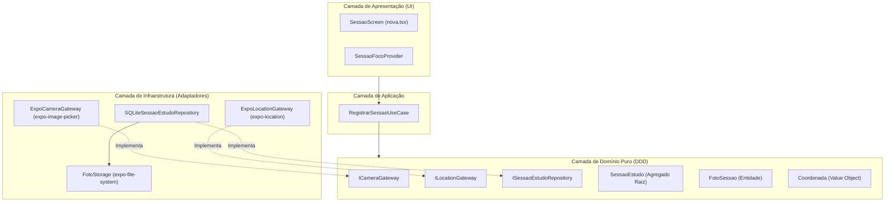

# Relatório Técnico de Engenharia de Software — Fase 3: StudyRats
**Módulo:** Câmera, Geolocalização e Persistência Relacional Local  
**Padrões Arquiteturais:** Clean Architecture, Domain-Driven Design (DDD), Test-Driven Development (TDD)  
**Status da Suíte de Testes:** 44/44 test suites verdes (172 testes unitários aprovados)

---

## 1. Contextualização e Visão Geral da Solução

O **StudyRats** é um ecossistema mobile gamificado concebido para combater a procrastinação e o isolamento de estudantes, concurseiros e vestibulandos.

```
       [ Dispositivo Móvel / Sensores Físicos ]
          │                           │
    (Câmera Fotográfica)      (Sensor de GPS)
          │                           │
          ▼                           ▼
┌──────────────────┐        ┌──────────────────┐
│   FotoSessao     │        │    Coordenada    │
│ (Evidência Real  │        │(Contexto Espacial│
│  do Caderno/Livro)│       │  da Sessão)      │
└─────────┬────────┘        └─────────┬────────┘
          │                           │
          └───────────┬───────────────┘
                      ▼
          ┌───────────────────────┐
          │     SessaoEstudo      │
          │   (Agregado Raiz)     │
          └───────────┬───────────┘
                      ▼
          ┌───────────────────────┐
          │ SQLite Nativo Local   │
          │  (Persistência WAL)   │
          └───────────────────────┘
```

### O Problema
Sistemas tradicionais de produtividade e cronômetros de estudo são excessivamente abstratos e baseados em auto-declaração passiva ("estudei 2 horas"). Isso acarreta:
1. **Baixa fidelidade das métricas:** Ausência de comprovação de foco efetivo.
2. **Isolamento e desmotivação:** Falta de compartilhamento tangível do progresso diário.
3. **Ausência de contexto ambiental:** Incapacidade de identificar onde o estudante rende melhor (biblioteca, faculdade, casa ou cafeteria).

### A Solução
Na Fase 3, o StudyRats agrega dois sensores de hardware do aparelho móvel à rotina de estudos:
* **Câmera:** O estudante captura a evidência visual do seu estudo (anotações, livros abertos, esquemas ou cadernos). A foto autentica a sessão e é compartilhada no Feed social da comunidade.
* **Geolocalização (GPS):** O app registra a latitude e longitude do local onde a sessão ocorreu, associando o ciclo de foco a um espaço geográfico real.
* **Persistência Local Confiável:** Todos os dados são consolidados em um banco de dados relacional local (SQLite) operando em modo offline-first.

---

## 2. Princípios Arquiteturais: Clean Architecture & DDD

A integridade do sistema é sustentada pela **Regra de Dependência**: elementos das camadas externas (UI, frameworks, SDKs e banco de dados) apontam para dentro, enquanto o Domínio é 100% puro e desconhece o mundo exterior.



### Onde aparecem a Câmera e a Geolocalização?

| Camada | Papel da Câmera | Papel da Geolocalização | Dependências Permitidas |
| :--- | :--- | :--- | :--- |
| **Domínio (`src/domain/`)** | Interface de contrato puro `ICameraGateway`; Entidade `FotoSessao` | Interface de contrato puro `ILocationGateway`; Value Object `Coordenada` | **Nenhuma**. Zero imports de React, Expo ou SO |
| **Aplicação (`src/application/`)** | Orquestra a captura opcional no caso de uso `RegistrarSessaoUseCase` | Solicita coordenadas e protege o fluxo contra falhas de GPS | Apenas contratos de `domain` |
| **Infraestrutura (`src/infrastructure/`)** | `ExpoCameraGateway` (chama `expo-image-picker`) e `FotoStorage` (`expo-file-system`) | `ExpoLocationGateway` (chama `expo-location`) | Módulos nativos, SDK Expo e SQLite |
| **Apresentação (`src/app/`, `src/providers/`)** | Exibição de prévia da foto, disparador de captura visual | Switch opcional "Anexar Localização", exibição de badge | React Native, Reanimated, Componentes UI |

### Prova Automatizada de Pureza Arquitetural
Para impedir que qualquer desenvolvedor acidentalmente importe bibliotecas de terceiros no Domínio, mantemos um teste de arquitetura automatizado em [architecture.spec.ts](file:///c:/Desenvolvimento/MOBILE_StudyRats/StudyRats/src/__tests__/architecture.spec.ts) que varre a AST de todos os arquivos:
* Garante que `src/domain/` não importa `react`, `react-native`, `expo`, `application` nem `infrastructure`.
* Garante que `src/application/` só se comunica através de abstrações e interfaces.

---

## 3. Modelagem de Domínio (DDD) e Contratos Puros

### 3.1. Value Object: `Coordenada`
Localizado em [Coordenada.ts](file:///c:/Desenvolvimento/MOBILE_StudyRats/StudyRats/src/domain/value-objects/Coordenada.ts), encapsula a posição geográfica da sessão:
* **Imutabilidade:** Sem setters públicos, suas propriedades (`latitude`, `longitude`, `timestamp`) são `readonly`.
* **Auto-validação no Factory:**
  $$\text{latitude} \in [-90, +90] \quad \text{e} \quad \text{longitude} \in [-180, +180]$$
  Caso contrário, lança erro antes de qualquer persistência.
* **Timestamp Temporal:** Preserva o momento exato em que a coordenada foi obtida pelos satélites.

### 3.2. Entidade: `FotoSessao`
Localizada em [FotoSessao.ts](file:///c:/Desenvolvimento/MOBILE_StudyRats/StudyRats/src/domain/entities/FotoSessao.ts), modela a evidência fotográfica:
* Identidade própria (`id`).
* `sessaoId`: Chave estrangeira de domínio que a vincula estritamente à sua sessão de estudo.
* `uriLocal`: Caminho seguro no sistema de arquivos local do celular.
* `urlRemota` e `uploadStatus`: Ciclo de vida para sincronização com bucket na nuvem (`pending`, `uploading`, `completed`, `error`).

### 3.3. Agregado Raiz: `SessaoEstudo`
Localizado em [SessaoEstudo.ts](file:///c:/Desenvolvimento/MOBILE_StudyRats/StudyRats/src/domain/entities/SessaoEstudo.ts):
* Mantém as regras invariantes: duração nunca pode ser negativa; usuário, disciplina e tópico são mandatórios.
* **Regra de integridade referencial interna:**
  ```typescript
  public anexarFoto(foto: FotoSessao): void {
    if (foto.sessaoId !== this.id) {
      throw new Error('A foto não pertence a esta sessão de estudo');
    }
    this._foto = foto;
  }
  ```

### 3.4. Interfaces e Contratos Declarativos
```typescript
// src/domain/gateways/ICameraGateway.ts
export interface ICameraGateway {
  capturarFoto(): Promise<string | null>;
}

// src/domain/gateways/ILocationGateway.ts
export interface Coordenadas {
  latitude: number;
  longitude: number;
}

export interface ILocationGateway {
  obterLocalizacaoAtual(): Promise<Coordenadas>;
}
```

---

## 4. O Caso de Uso: Orquestração e Resiliência

O [RegistrarSessaoUseCase.ts](file:///c:/Desenvolvimento/MOBILE_StudyRats/StudyRats/src/application/use-cases/RegistrarSessaoUseCase.ts) consolida o ciclo de foco do usuário.

```
                  [ Iniciar Caso de Uso: RegistrarSessao ]
                                     │
                        ┌────────────┴────────────┐
                        ▼                         ▼
            [ Buscar Usuário por ID ]    [ anexarGps é verdadeiro? ]
                        │                         │
                   (Encontrado?)           ┌──────┴──────┐
                        │                 SIM           NÃO
                        │                  │             │
                        │           [ Obter GPS ]        │
                        │           (Try / Catch)        │
                        │                  │             │
                        │        ┌─────────┴─────────┐   │
                        │     (Sucesso)           (Falha)│
                        │        │                   │   │
                        │   Coordenada          undefined│
                        │        └─────────┬─────────┘   │
                        │                  ▼             │
                        │          [ Coordenada Pronta ] ◄
                        │                  │
                        └──────────┬───────┘
                                   ▼
                    [ Criar Agregado SessaoEstudo ]
                                   │
                    ┌──────────────┴──────────────┐
                    ▼                             ▼
              comFoto = SIM                 comFoto = NÃO
                    │                             │
          (FotoUri informada?)                    │
            ┌───────┴───────┐                     │
           SIM             NÃO                    │
            │               │                     │
      Reaproveita     Chama Câmera                │
            │          (ICameraGateway)           │
            └───────┬───────┘                     │
                    ▼                             ▼
             [ Anexar Foto ]                      │
                    │                             │
                    └──────────────┬──────────────┘
                                   ▼
                       [ Atribuir XP ao Usuário ]
                                   │
                      [ Salvar em Repositórios ]
                        1. SessaoRepository
                        2. UsuarioRepository
                                   │
                                   ▼
                          (Retorno: Sucesso)
```

### Decisões Arquiteturais Fundamentais:
1. **GPS como Evidência Opcional Resiliente:** Se o usuário estiver no subsolo, em modo avião ou recusar permissão de GPS, a sessão **nunca é abortada**. O método privado `obterCoordenada()` intercepta a exceção e retorna `undefined`, garantindo que o estudante não perca seu tempo de estudo ou XP.
2. **Reaproveitamento de Foto Pré-Capturada:** A UI permite tirar a foto antes ou durante o encerramento da sessão. Se `fotoUri` já vier preenchida pela UI, o caso de uso não abre a câmera novamente.
3. **Cancelamento Gracioso:** Se o usuário aciona a câmera e aperta "Cancelar", o gateway retorna `null` e a sessão é registrada normalmente sem anexo fotográfico.

---

## 5. Estratégia de TDD (Test-Driven Development)

O desenvolvimento de hardware móvel com TDD convencional costuma ser lento devido à necessidade de builds para emuladores. Nossa estratégia baseou-se em **testes herméticos e desacoplados** executados em Node.js.

### 5.1. Mocks de Domínio para Testar a Aplicação
No arquivo [RegistrarSessaoUseCase.spec.ts](file:///c:/Desenvolvimento/MOBILE_StudyRats/StudyRats/src/application/use-cases/__tests__/RegistrarSessaoUseCase.spec.ts), criamos implementações controladas de teste:

```typescript
class MockCameraGateway implements ICameraGateway {
  shouldCancel = false;
  async capturarFoto(): Promise<string | null> {
    if (this.shouldCancel) return null;
    return 'file:///fake/path/foto.jpg';
  }
}

class MockLocationGateway implements ILocationGateway {
  permissaoNegada = false;
  async obterLocalizacaoAtual(): Promise<Coordenadas> {
    if (this.permissaoNegada) throw new Error('Permissão de localização negada');
    return { latitude: -23.5505, longitude: -46.6333 };
  }
}
```

### 5.2. Teste dos Adaptadores de Infraestrutura com Jest Spies
Em [Gateways.spec.ts](file:///c:/Desenvolvimento/MOBILE_StudyRats/StudyRats/src/infrastructure/gateways/__tests__/Gateways.spec.ts), espionamos e validamos as chamadas aos módulos nativos do Expo:
* Verificação de que permissões `denied` lançam exceções legíveis.
* Verificação de que `requestCameraPermissionsAsync` e `launchCameraAsync` recebem os parâmetros adequados de qualidade (`0.8`) e edição.
* Verificação de que `getCurrentPositionAsync` converte o payload da plataforma em `Coordenadas`.

---

## 6. A Infraestrutura: Adaptadores Concretos do Expo

Os adaptadores implementam as portas declaradas pelo Domínio, respeitando o princípio de que **a tecnologia se curva às necessidades do negócio**.

### 6.1. `ExpoCameraGateway`
Implementado em [ExpoCameraGateway.ts](file:///c:/Desenvolvimento/MOBILE_StudyRats/StudyRats/src/infrastructure/gateways/ExpoCameraGateway.ts):
```typescript
export class ExpoCameraGateway implements ICameraGateway {
  constructor(private persistirFoto?: (uriTemp: string) => Promise<string>) {}

  async capturarFoto(): Promise<string | null> {
    const { status } = await ImagePicker.requestCameraPermissionsAsync();
    if (status !== 'granted') throw new Error('Permissão de câmera negada');

    const result = await ImagePicker.launchCameraAsync({
      mediaTypes: ImagePicker.MediaTypeOptions.Images,
      allowsEditing: true,
      quality: 0.8,
    });

    if (!result.canceled && result.assets && result.assets.length > 0) {
      const uriTemp = result.assets[0].uri;
      if (this.persistirFoto) return await this.persistirFoto(uriTemp);
      return uriTemp;
    }
    return null;
  }
}
```

### 6.2. `FotoStorage` (Gerenciador de Arquivos Permanentes)
Implementado em [FotoStorage.ts](file:///c:/Desenvolvimento/MOBILE_StudyRats/StudyRats/src/infrastructure/storage/FotoStorage.ts):
* **Problema Resolvido:** O `expo-image-picker` grava fotos no diretório temporário de cache (`/cache`), que pode ser apagado pelo sistema operacional a qualquer momento para liberar espaço.
* **Solução:** O `FotoStorage` copia o arquivo com segurança para `FileSystem.Paths.document/fotos_sessao/`, garantindo nomes únicos e preservação perene da foto no celular.

### 6.3. `ExpoLocationGateway`
Implementado em [ExpoLocationGateway.ts](file:///c:/Desenvolvimento/MOBILE_StudyRats/StudyRats/src/infrastructure/gateways/ExpoLocationGateway.ts):
* Solicita permissão em primeiro plano (`requestForegroundPermissionsAsync`).
* Consulta a posição de satélite com alta precisão (`getCurrentPositionAsync`).

### 6.4. Configurações de Manifesto no `app.json`
As permissões nativas requeridas para Android e iOS estão declaradas expressamente:
```json
"plugins": [
  [
    "expo-location",
    { "locationWhenInUsePermission": "O StudyRats usa sua localização para registrar onde você estudou." }
  ],
  [
    "expo-image-picker",
    { "cameraPermission": "O StudyRats usa a câmera para registrar a foto do seu caderno de estudo." }
  ],
  "expo-sqlite"
]
```

---

## 7. Persistência Relacional: SQLite Nativo no Celular

Para cumprir o requisito de **salvar os dados de câmera e localização no banco de dados local do celular**, empregamos a API moderna do `expo-sqlite`.

### 7.1. Schema e Migrations Idempotentes
Definido em [migrations.ts](file:///c:/Desenvolvimento/MOBILE_StudyRats/StudyRats/src/infrastructure/database/migrations.ts), o banco utiliza a convenção recomendada pelo SQLite de controle de versão por `PRAGMA user_version`:

```sql
CREATE TABLE IF NOT EXISTS sessoes_estudo (
  id TEXT PRIMARY KEY NOT NULL,
  usuario_id TEXT NOT NULL,
  disciplina_id TEXT NOT NULL,
  topico_id TEXT NOT NULL,
  duracao_minutos INTEGER NOT NULL,
  created_at TEXT NOT NULL,
  sync_status TEXT NOT NULL DEFAULT 'pending',
  latitude REAL,
  longitude REAL,
  coordenada_timestamp TEXT
);
CREATE INDEX IF NOT EXISTS idx_sessoes_usuario ON sessoes_estudo (usuario_id, created_at DESC);
CREATE INDEX IF NOT EXISTS idx_sessoes_disciplina ON sessoes_estudo (disciplina_id, created_at DESC);

CREATE TABLE IF NOT EXISTS fotos_sessao (
  id TEXT PRIMARY KEY NOT NULL,
  sessao_id TEXT NOT NULL UNIQUE REFERENCES sessoes_estudo (id) ON DELETE CASCADE,
  uri_local TEXT NOT NULL,
  url_remota TEXT,
  upload_status TEXT NOT NULL DEFAULT 'pending'
);
```

### 7.2. Características da Modelagem Relacional
1. **Embutimento de Value Object:** A `Coordenada` não possui tabela própria (por não ser uma entidade com identidade independente); seus atributos (`latitude`, `longitude`, `coordenada_timestamp`) ficam embutidos diretamente na linha da sessão.
2. **Entidade Dependente com Cascata:** A tabela `fotos_sessao` possui chave estrangeira para `sessoes_estudo` com restrição `ON DELETE CASCADE` e unicidade `UNIQUE`, assegurando que cada sessão possui no máximo uma foto e que, ao apagar a sessão, o registro da foto é excluído atomicamente.
3. **Desempenho com WAL:** O banco é inicializado com `PRAGMA journal_mode = WAL;` (Write-Ahead Logging) e `PRAGMA foreign_keys = ON;` em [database.ts](file:///c:/Desenvolvimento/MOBILE_StudyRats/StudyRats/src/infrastructure/database/database.ts), permitindo leituras concorrentes sem travamento de escrita.

### 7.3. O Adaptador: `SQLiteSessaoEstudoRepository`
Implementado em [SQLiteSessaoEstudoRepository.ts](file:///c:/Desenvolvimento/MOBILE_StudyRats/StudyRats/src/infrastructure/repositories/SQLiteSessaoEstudoRepository.ts):
* Opera em transação atômica (`withTransactionAsync`).
* Utiliza `INSERT ... ON CONFLICT(id) DO UPDATE` para realizar upsert idempotente.
* Reconstitui o agregado `SessaoEstudo` completo através de `LEFT JOIN fotos_sessao` nas consultas.

---

## 8. Matriz de Evidências Reais do Projeto

A tabela a seguir consolida as evidências verificáveis de código e testes:

| Decisão Arquitetural | Benefício Técnico | Arquivo de Implementação | Arquivo de Teste Automatizado |
| :--- | :--- | :--- | :--- |
| **Domínio 100% Puro** | Independência de frameworks e vida útil longa do código | [ICameraGateway.ts](file:///c:/Desenvolvimento/MOBILE_StudyRats/StudyRats/src/domain/gateways/ICameraGateway.ts), [Coordenada.ts](file:///c:/Desenvolvimento/MOBILE_StudyRats/StudyRats/src/domain/value-objects/Coordenada.ts) | [architecture.spec.ts](file:///c:/Desenvolvimento/MOBILE_StudyRats/StudyRats/src/__tests__/architecture.spec.ts) |
| **GPS Opcional Resiliente** | Falha de sinal ou rejeição de permissão não impede conclusão do estudo | [RegistrarSessaoUseCase.ts](file:///c:/Desenvolvimento/MOBILE_StudyRats/StudyRats/src/application/use-cases/RegistrarSessaoUseCase.ts) | [RegistrarSessaoUseCase.spec.ts](file:///c:/Desenvolvimento/MOBILE_StudyRats/StudyRats/src/application/use-cases/__tests__/RegistrarSessaoUseCase.spec.ts) |
| **Câmera com Cancelamento Gracioso** | Aplicação não quebra se usuário fechar a câmera | [RegistrarSessaoUseCase.ts](file:///c:/Desenvolvimento/MOBILE_StudyRats/StudyRats/src/application/use-cases/RegistrarSessaoUseCase.ts) | [RegistrarSessaoUseCase.spec.ts](file:///c:/Desenvolvimento/MOBILE_StudyRats/StudyRats/src/application/use-cases/__tests__/RegistrarSessaoUseCase.spec.ts) |
| **Persistência Segura de Fotos** | Fotos não são perdidas quando o SO limpa o cache temporário | [FotoStorage.ts](file:///c:/Desenvolvimento/MOBILE_StudyRats/StudyRats/src/infrastructure/storage/FotoStorage.ts) | [FotoStorage.spec.ts](file:///c:/Desenvolvimento/MOBILE_StudyRats/StudyRats/src/infrastructure/storage/__tests__/FotoStorage.spec.ts) |
| **Persistência Relacional SQLite** | Consultas rápidas indexadas e integridade referencial com cascata | [SQLiteSessaoEstudoRepository.ts](file:///c:/Desenvolvimento/MOBILE_StudyRats/StudyRats/src/infrastructure/repositories/SQLiteSessaoEstudoRepository.ts) | [SQLiteSessaoEstudoRepository.spec.ts](file:///c:/Desenvolvimento/MOBILE_StudyRats/StudyRats/src/infrastructure/repositories/__tests__/SQLiteSessaoEstudoRepository.spec.ts) |
| **Schema Versionado por Migration** | Atualização segura do banco em novas versões sem corromper dados | [migrations.ts](file:///c:/Desenvolvimento/MOBILE_StudyRats/StudyRats/src/infrastructure/database/migrations.ts) | [migrations.spec.ts](file:///c:/Desenvolvimento/MOBILE_StudyRats/StudyRats/src/infrastructure/database/__tests__/migrations.spec.ts) |

---
**Conclusão da Fase 2:** Todos os requisitos arquiteturais, contratos de domínio, fluxos de aplicação, testes de TDD e implementações de infraestrutura e persistência local estão minuciosamente documentados e validados por evidências de código reais.

